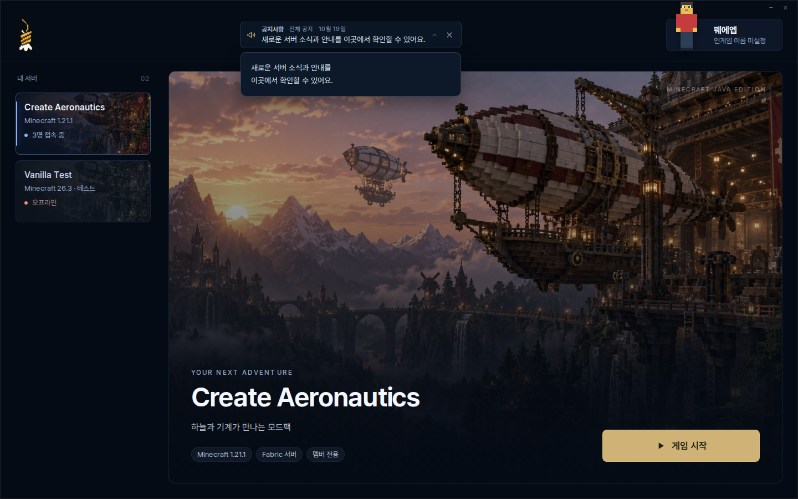
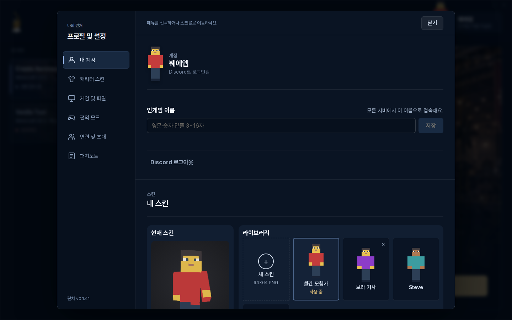
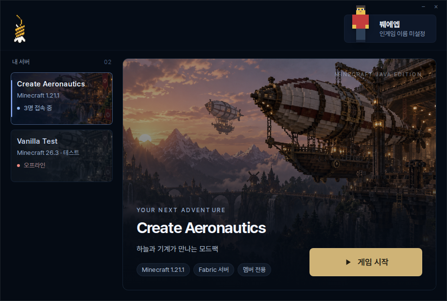

# 런처 디자인과 화면 검증

최신 main의 실행·설치·자동 업데이트 구현 위에 사용자가 검토한 디자인을 옮겼다. 이 변경은 버전을 올리거나 정식 배포를 실행하지 않는다.

- 메인은 런처 아이콘, 오른쪽 프로필, 서버 카드 전용 목록, 큰 게임 이미지와 실행 영역으로 구성한다. 영문 워드마크·상단 아이콘 메뉴·별도 접속 정보 패널은 제거하고 각 서버 카드 안에 짧은 상태를 표시한다.
- 프로필에는 적용한 Minecraft 스킨 전신을 표시한다. 프로필 버튼으로 왼쪽 메뉴와 연속 스크롤 본문을 가진 설정창 하나를 연다. 메뉴 이동 중 입력 초안과 도구 상태를 유지하고 같은 설정을 중복 표시하지 않는다. 관리 메뉴는 관리자에게만 보인다.
- 공지는 헤더의 로고와 프로필 사이 한 곳에 표시한다. 배너는 최대 400×48px이며, 클릭하면 아래에 원래 줄바꿈을 유지한 전체 내용이 펼쳐진다. 다시 클릭하거나 Escape·바깥 클릭으로 접는다. X는 기존처럼 해당 공지를 숨기며 숨긴 ID 저장·새 공지 표시·개인 공지 우선 정책을 유지한다.
- 실제 실행 단계·총량이 있는 진행률·서버 선택 잠금·게임 종료 후 복구·자동 업데이트 처리는 기존 bridge와 연결한다. 스킨 3D 미리보기는 설정을 닫거나 화면 밖으로 이동하면 렌더링을 멈춘다.

주요 파일은 `src/renderer/App.tsx`, `SettingsHub.tsx`, `PanelSurface.tsx`, `SkinFront.tsx`, `settings.css` 및 기존 도구의 내장 표시 모드다. 배경은 프로젝트의 Create 이미지, 로고는 기존 `build/icon-source-v2.png`를 사용한다. 참고 제품의 캡처는 배포 자산에 포함하지 않는다.

## 변경 화면

아래 화면의 계정·서버·공지·인원은 샘플이다. 실행 시간 측정 결과가 아니다.







## 재현

WSL `Ubuntu-Dev-Local`의 `dev` 사용자 또는 독립된 Linux 개발 환경에서 저장소 루트를 기준으로 실행한다.

```sh
npm ci
npm run build
npm exec vite -- --config scripts/vite.design.config.ts --host 127.0.0.1 --port 5195 --strictPort
```

미리보기 주소는 `http://127.0.0.1:5195/?design-preview&notice`다. `signed-out`은 로그인 전 화면, `launch-flow`는 가짜 진행 이벤트를 천천히 보여주는 화면이다. 이 전용 Vite 설정과 가짜 bridge는 제품 빌드에 포함되지 않는다.

다른 터미널에서 실행한다.

```sh
BWEEP_PREVIEW_URL=http://127.0.0.1:5195 node scripts/capture-design-review.mjs
git diff --check
```

일반 bridge 회귀 검사는 별도의 기본 Vite 서버에서 실행한다.

```sh
npm exec vite -- --host 127.0.0.1 --port 5196 --strictPort
# 다른 터미널
BWEEP_PREVIEW_URL=http://127.0.0.1:5196 node scripts/capture-preview.mjs
BWEEP_PREVIEW_URL=http://127.0.0.1:5196 BWEEP_PREVIEW_ADMIN=true node scripts/capture-preview.mjs
BWEEP_PREVIEW_URL=http://127.0.0.1:5196 BWEEP_PREVIEW_MOVE_AND_MODS=true node scripts/capture-preview.mjs
BWEEP_PREVIEW_URL=http://127.0.0.1:5196 BWEEP_PREVIEW_MEMBER=true node scripts/capture-preview.mjs
```

화면 검사는 설정 중복 없음·연속 스크롤·입력 유지·스킨 반영·920×620 배치·키보드 조작·실제 진행 이벤트 표시·카드 잠금·공지 펼치기와 숨김 지속성을 확인한다.

결과와 PNG는 `design/screens/verification.json` 및 같은 폴더에 생성된다. PR CI도 전용 화면 검사를 실행하고 캡처를 artifact로 보관한다. 실제 설치본의 로그인 유지·자동 업데이트·게임 접속은 이 fixture 검사의 범위가 아니며 배포 전 별도로 검증해야 한다. 기존 skinview3d 청크 크기 경고는 남아 있다.

버전·패키지 의존성·main/preload/shared·서버 모드·DB·운영 서비스는 이 디자인 변경의 대상이 아니다. 병합 후 문제가 있으면 이 PR을 되돌리는 새 PR로 복구한다.
